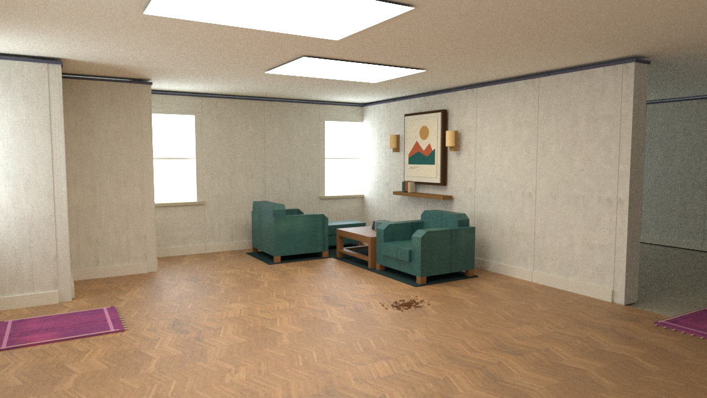

# Scout-assisted home vacuum

[Task PR](https://github.com/Grounded-Intelligence-Initiative/agentic-robotics-benchmark/pull/210) | [Task, instructions and verifier](https://github.com/Waybaba/agentic-robotics-benchmark/tree/5a9739950b3a3a256dd2b774922ca5cdee401eeb/tasks/ground/scout_assisted_home_vacuum)

An indoor scout reads a physical work card and surveys an unfamiliar apartment. A ground vacuum must clean the two named rooms and the hallway, preserve lookalike powder elsewhere, move one carton to two selected mats in order, and dock without scuffing rugs. The scout has 36 ticks; both robots share the 200-tick deadline. Neither receives a floor plan.



| View | What it shows |
|---|---|
| [Daylight interior](room-daylight.jpg) | Offline CPU path trace of the simulator's furnishings, walls and material textures, with a review camera and presentation lighting. Not a photograph or a robot observation. |
| [Native MuJoCo interior](engine-interior.jpg) | The same room with benchmark lighting, from an interior review camera. |
| [Robot cameras and reviewer overview](robot-cameras.png) | The two small, local RGB views are what the robots get. The wide overview is never sent to the solver. |
| [Work card as seen by the scout](dispatch.png) | Actual public camera frame and an enlarged example of the four swatches. |
| [11-second MP4](replay.mp4) / [GIF](replay.gif) | Two onboard views plus a reviewer map, from the camera-only reference. All goals met at tick 140 in the public apartment (617). |

The floor plans, furniture obstructions, orders and camera mounts vary. Apartment movement is discrete; the benchmark tests cooperation under partial observation, not flight stabilization or transfer to a physical home. The images and viewer map on this branch are not installed in the participant's environment.

## Evidence guide

- [Final engine validation](validation.json), [reference verification](oracle.json), [paired controls](dispatch-controls.jsonl) and [30 different reference development cases](reference-panel.jsonl). The [first validation](before-reference-fix-validation.json) missed one spill and returned 0.94; the final reference corrects its memory of occluded frontiers. It completed 6/6 hidden homes, scoring 1.00 against an empty submission's 0.00. Only the author controller changed at `5a973995`; the environment, solver inputs, deadline and scoring are identical to `67802451`.
- [Fresh Astra run](dispatch-astra.json): **4/6** full homes, **0.85/1**, with both carton milestones in all six. The [frozen program](dispatch-frozen.json) then completed **10/12** new homes (4/6 and 6/6; rewards 0.83 and 1.00). The replays do not use extra model calls and are not independently authored solutions. This is not evidence that a frontier model generally fails the task.
- Earlier calibrations: [single delivery](single-stop-astra.json), [two deliveries with the order in text](ordered-delivery-astra.json), [same text-order solver on 12 further homes](ordered-delivery-frozen.json). The legacy controls `paired-200.jsonl` and `paired-160.jsonl` are for the text-order version, not the current work-card version.
- On the same six layouts, ground-only completed **0/6**. Even with the correct order supplied, ground-only completed **3/6**; fixed-scout and adaptive-scout both completed **6/6**, averaging 163.2 and 155.5 ticks respectively. Only `informed-solo` gets the privileged order. This is evidence about these controllers, not a universal claim that every task requires two robots.
- [Sanitized provenance](provenance.json) records the measured Git commits, engine, harness, resource limits and lock hashes. No account material or private evaluator seeds are published.

## Reproduce the visuals

Use the pinned task requirements and CPU Mesa OSMesa; the optional presentation photo also uses Mitsuba 3.7.1. Point `TASK` to the linked task directory.

```bash
export MUJOCO_GL=osmesa PYOPENGL_PLATFORM=osmesa CUDA_VISIBLE_DEVICES="" LP_NUM_THREADS=1
python "$TASK/tests/diagnostics/gallery.py" --seed 617 --preview home.png --dispatch dispatch.png
python replay.py --task "$TASK" --seed 617 --output replay.gif
python photo.py --task "$TASK" --seed 617 --room oak --width 1160 --spp 640 --output room-daylight.png
```

The task's `tests/furnishings/CREDITS.md` and `tests/interior_materials/CREDITS.md` credit the CC0 Kenney meshes and Poly Haven surface photographs. [Suggested website card](suggested-card.toml) for a maintainer; this branch is evidence, not a second task submission.
