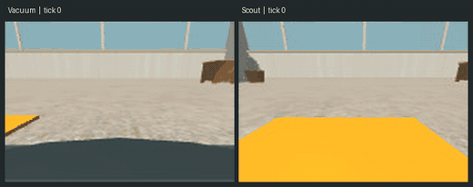

# Egocentric apartment pilot

[Source and instructions](https://github.com/Waybaba/agentic-robotics-benchmark/tree/a7e0d68681af1579a955f018e08a44d54914cc27/tasks/ground/scout_assisted_home_vacuum) | [True onboard triptych](https://github.com/Waybaba/agentic-robotics-benchmark/blob/a7e0d68681af1579a955f018e08a44d54914cc27/tasks/ground/scout_assisted_home_vacuum/tests/diagnostics/onboard/egocentric-scout.jpg).

[MP4, 11 seconds](first-person.mp4). Left: vacuum camera. Right: quadrotor camera; the feed stops at battery expiry. These are the actual JPEG observations from a successful 221-tick rollout; the controller is the privileged author pilot, not an LLM. The public action sequence replays on fresh physics. The original review PR still measures the previous, overhead-camera task.
